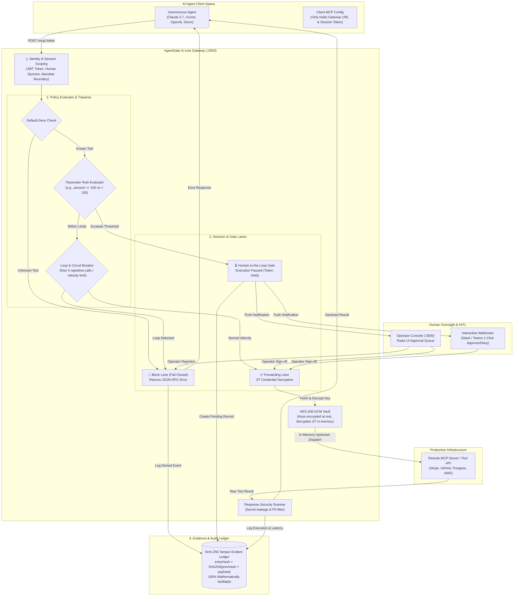

# AgentGate: The Authorization & Earned Autonomy Layer for AI Agents
### Comprehensive Summary: Product Evolution, System Architecture, Workflows & Strategic Insights

---

## 1. Executive Summary & Core Thesis

Autonomous AI agents powered by frontier LLMs (Claude 3.7, OpenAI o3, Cursor, Devin) are rapidly transitioning from conversational chat sandboxes into **high-stakes operational workflows**: executing database migrations, issuing refunds, interacting with payment gateways (Agentic Commerce), configuring cloud infrastructure, and managing production repositories.

However, existing enterprise authorization models are **binary and identity-deficient**:
* **All-or-Nothing API Keys:** When an agent is handed an API key (Stripe secret key, GitHub PAT, AWS credentials), it possesses carte-blanche authority to execute any action that key permits. An agent intended to issue a $20 customer refund has the raw technical power to drain the merchant balance or delete customer records.
* **Prompt Engineering is Not a Security Boundary:** System prompts like *"Never delete tables"* or *"Only spend under $50"* fail reliably under adversarial prompt injection, context overflow, or reasoning drift.
* **Gut-Feel Security Posture:** Because enterprise security teams (CISOs, SecOps) cannot measure agent trustworthiness, 85% of enterprise AI agent initiatives remain trapped in low-impact internal demos.

> **The AgentGate Core Promise:**  
> Every action an AI agent takes—internally or on behalf of an enterprise—is **identified**, **parameter-bounded**, **human-approved when risky**, and **immutably proven with cryptographic evidence**.

---

## 2. Our Journey & Back-and-Forth Redefining of the Idea

```
┌────────────────────────────────────────────────────────────────────────────────────────┐
│                                 THE EVOLUTION OF AGENTGATE                              │
├────────────────────────────────────────────────────────────────────────────────────────┤
│ PHASE 0: The Initial MVP Proxy                                                         │
│ • Simple proxy sitting between agent and MCP server.                                   │
│ • Default was allow-all, plaintext tokens in SQLite, log file on disk.                 │
│ • Realization: A toy proxy is a feature, not a venture-backed startup.                │
├────────────────────────────────────────────────────────────────────────────────────────┤
│ PHASE 1: The Competitive Awakening & The Solo Builder Dilemma                          │
│ • Studied Runlayer ($11M Seed, $30M Series A), Cloudflare AI Gateway, MintMCP.        │
│ • Runlayer built a 4-pillar suite (Discovery, Catalog, Gateway, Audit) with 40 people.│
│ • Critical Feedback: A solo founder cannot build 4 enterprise pillars before funding. │
│ • The Pivot: Drop discovery & routing; build Pillar 4 (Governance) + Pillar 3 (Audit).│
├────────────────────────────────────────────────────────────────────────────────────────┤
│ PHASE 2: The Wedge — "Earned Autonomy & Money Guardrails"                              │
│ • Focus where risk is existential: Capital & Production Mutations.                    │
│ • Fail-Closed Default Deny + Parameter-Aware Policy Engine (amount <= $100 vs > $100).│
│ • Loop & Circuit Breaker: Stop runaway loops before burning weekend budgets.          │
│ • 14-Day Watch Mode: 90-second frictionless install with zero risk of breaking agents.│
├────────────────────────────────────────────────────────────────────────────────────────┤
│ PHASE 3: The Measurement Engine & Cryptographic Evidence Ledger                       │
│ • "You cannot improve what you cannot measure." Replace gut-feel with data.           │
│ • Autonomy Readiness Score (ARS): Mathematical score (0–100) determining promotion.  │
│ • Hash-Chained Tamper-Evident Audit Log: SHA-256 blockchain-style mathematical proof. │
├────────────────────────────────────────────────────────────────────────────────────────┤
│ PHASE 4: Enterprise Control Plane UI & Production Hardening                            │
│ • Revamped entire UI with Radix UI primitives & shadcn (Tabs, Dialogs, Progress, etc).│
│ • In-line interactive policy simulator + 14-day baseline pilot scorecard generator.   │
│ • Zero raw key exposure (AES-256 vault) + passing all 11 end-to-end integration tests.│
└────────────────────────────────────────────────────────────────────────────────────────┘
```

### The Initial State vs. Market Reality
We started with AgentGate as an early-stage MCP (Model Context Protocol) proxy. While functional, deep competitive analysis showed that **a raw MCP proxy is a commodity feature**:
* Cloudflare launched AI Gateway for routing and caching.
* Docker launched an MCP tool catalog.
* Runlayer signed dozens of enterprise customers and raised $41M across Seed and Series A by selling a complete governance suite to CISOs.

### The Solo Builder Trap & The Pre-Seed Realignment
The initial impulse when looking at Runlayer is to build everything: an enterprise tool catalog, shadow agent network discovery, in-line proxying, and cost analytics. 

**The Breakthrough Realization:**
1. A solo founder attempting to build all 4 pillars before pre-seed funding will deliver an unfinished MVP of everything and close zero deals.
2. What closed Runlayer's seed round was not a feature checkbox—it was early enterprise pilot proof and real operational stories (e.g., an agent burning an entire quarterly budget over a weekend in an infinite retry loop).
3. **The Wedge:** Win on **parameter-level runtime enforcement**, **money/production blast radius protection**, and **immutable evidence**.

### The Shift from "Blocker" to "Measurement Instrument"
Enterprise sales fail when a security tool threatens to break developer velocity. If AgentGate defaults to blocking on Day 1, developers will route around it.
* **The 14-Day Watch Mode (Shadow Mode)** was born: AgentGate deploys passively in 90 seconds. It intercepts tool traffic, allows execution, and measures the baseline alignment rate, error loop index, and blast radius risk.
* On Day 14, AgentGate automatically outputs the **Baseline Measurement Scorecard**, demonstrating: *"Your agent attempted 590 calls; 9 would have breached safety limits ($34,800 exposure); 2 runaway loops were caught. Here is your mathematically justified policy."*
* This converts a security hurdle into an undeniable buying decision.

---

## 3. System Architecture & The 4-Layer Defense

AgentGate operates as an in-line, fail-closed authorization engine sitting between any LLM agent framework and upstream MCP servers or REST APIs.

### Architectural Diagram



---

## 4. The Four Pillars of Defense

### Pillar 1: Identity & Ephemeral Session Tokens
* AI agents never receive raw API keys or database connection strings.
* Upstream credentials are saved once into the AgentGate proxy vault and encrypted with **AES-256-GCM**.
* When an agent session is initialized, AgentGate generates an ephemeral, cryptographically signed JWT scoped by:
  * `agentId`: Unique identity linked to a named human owner/sponsor.
  * `mandate`: Machine-readable statement of what the agent is allowed to do.
  * `expiresAt`: Hard time-to-live limit (e.g. 60 minutes).
  * `mode`: `enforce` (fail-closed active blocking) or `watch` (shadow passive observation).

### Pillar 2: Parameter-Aware Fail-Closed Policy Engine
Standard firewalls and proxies evaluate permissions at the tool name level (`allow stripe`). AgentGate inspects the internal arguments payload:
* **Threshold Evaluation:**
  * `stripe/refund` where `amount <= 100` $\to$ **Allowed automatically**.
  * `stripe/refund` where `100 < amount <= 1000` $\to$ **Requires Human Approval**.
  * `stripe/refund` where `amount > 1000` $\to$ **Fail-closed blocked**.
* **Path Globbing:**
  * `filesystem/read_file` on `src/**` $\to$ **Allowed**.
  * `filesystem/read_file` matching `**/.env*`, `**/secrets/**`, or `id_rsa` $\to$ **Denied fail-closed**.
* **SQL Safety:**
  * Parameter inspection catches destructive DDL (`DROP TABLE`, `ALTER USER`, `TRUNCATE`) and terminates execution before queries reach the database.

### Pillar 3: Runaway Loop Breaker & Circuit Breakers
Agents often enter hallucination or retry thrashing loops when an API returns an unexpected schema:
* AgentGate tracks invocation velocity and argument similarity per session.
* If an agent calls the identical tool with identical or failing parameters $\ge 5$ times in rapid succession, the **circuit breaker trips**.
* The session is locked fail-closed, preventing massive financial or LLM token spend.

### Pillar 4: Cryptographic SHA-256 Tamper-Evident Audit Ledger
To satisfy SOC 2, ISO 27001, and financial compliance, audit logs cannot simply be rows in a database that a rogue admin or SQL injection could mutate:
* Every audit record calculates an immutable cryptographic block hash:
  $$\text{entryHash} = \text{SHA-256}(\text{prevHash} \mathbin{\Vert} \text{timestamp} \mathbin{\Vert} \text{agentId} \mathbin{\Vert} \text{toolName} \mathbin{\Vert} \text{args} \mathbin{\Vert} \text{effect} \mathbin{\Vert} \text{reason})$$
* Any modification, deletion, or back-dating of any entry breaks the mathematical verification of the entire chain.
* A single click on the dashboard verifies mathematical integrity across all historical entries.

---

## 5. End-to-End Operational Workflows

### Workflow A: Registering an Agent & Mandate
1. Security Operator navigates to the AgentGate Console (`/agents`).
2. Registers a new agent identity:
   * **Name:** `Finance-Ops-Copilot`
   * **Human Sponsor:** `alex.ciso@enterprise.com`
   * **Mandate:** *"Process customer refunds under $100 and check billing status. Never delete accounts."*
3. AgentGate assigns an initial **Autonomy Level 1: Shadow** with an initial Autonomy Readiness Score (ARS) baseline.

### Workflow B: Connecting Upstream MCP Tools & Encrypted Ingestion
1. Operator adds an MCP service (e.g. Stripe, GitHub, Postgres, Filesystem).
2. Credentials (API keys, DB URIs) are pasted via dashboard.
3. The Proxy service encrypts the secrets at rest using **AES-256-GCM** with a rotating master key.
4. AgentGate queries the upstream tool definitions (`tools/list`) and registers available schemas.

### Workflow C: Spawning a Session (Enforce vs. Watch Mode)
1. The developer or orchestrator initializes a session:
   * Selects `enforce` mode for live production guardrails, or `watch` mode for a 14-day zero-risk pilot.
   * Defines parameter rules (e.g. `amount <= 100` allow, `amount > 100` require approval).
2. AgentGate returns a secure gateway connection string:
   `http://localhost:3003/mcp/<JWT_SESSION_TOKEN>`
3. The developer places this URL in their Claude Desktop, Cursor, or AutoGPT config. The agent never sees the upstream API key.

### Workflow D: Live Tool Interception & Gate Decision
```
AI Agent triggers tool call
       │
       ▼
POST /mcp/:token
       │
       ├──► 1. Verify JWT signature & expiration
       ├──► 2. Check session status (active vs revoked)
       ├──► 3. Check loop circuit breaker (tripped?)
       ├──► 4. Match tool against whitelist (unknown = fail-closed block)
       └──► 5. Evaluate argument parameters
```
* **If Allowed:** AgentGate fetches the encrypted key from the vault, decrypts it in-memory, forwards the JSON-RPC payload to the upstream MCP server, scans the response for leaked secrets, logs the SHA-256 audit entry, and streams the result back to the agent.
* **If Gated (Requires Approval):** 
  * Execution is paused.
  * AgentGate generates an approval request with an execution token.
  * Webhook alert dispatches to Slack / Teams and the Operator Approvals Queue.
  * When authorized, execution resumes seamlessly.
* **If Denied:** 
  * Execution halts immediately.
  * The blocked attempt is recorded in the SHA-256 audit ledger.
  * Fail-closed error returns to the agent.

---

## 6. The Earned Autonomy Ladder & Mathematical Scorecard

Enterprises should never grant blanket autonomy to an AI agent based on developer intuition. AgentGate replaces intuition with **verifiable earned autonomy**:

```
LEVEL 1: SHADOW          LEVEL 2: APPROVE          LEVEL 3: SAMPLED          LEVEL 4: GOVERNED
(14-Day Watch Mode)      (100% Human Review)       (10% Random Audit)        (Bounded Autonomous)
       │                        │                         │                          │
       ▼                        ▼                         ▼                          ▼
  Days 1 to 14             ARS ≥ 70                  ARS ≥ 90                   ARS ≥ 98
 Passive Telemetry        Min 20 Calls              Min 100 Calls              Min 500 Calls
  Baseline Mapped       Zero Human Edits          < 1% Discrepancy           0 Incidents / 30d
```

### The Autonomy Readiness Score (ARS) Formulation

$$\mathbf{ARS} = \left( w_A \cdot S_{\text{align}} + w_S \cdot S_{\text{stability}} + w_B \cdot S_{\text{blast}} \right) \times (1 - R_{\text{incident}})$$

| Dimension | Formula / Metric | Description |
|---|---|---|
| **$S_{\text{align}}$ (Human Alignment)** | $\frac{\text{Approved Calls}}{\text{Total Approval Requests}} \times 100$ | Measures operator agreement rate. Penalizes rejections and manual argument overrides. |
| **$S_{\text{stability}}$ (Execution Stability)** | $100 - (\text{Loop Breaker Trips} \times 20 + \text{Tool Error Rate} \times 50)$ | Penalizes repetitive thrashing, runaway retries, and API 5xx errors. |
| **$S_{\text{blast}}$ (Blast Radius)** | $100 \times \left(1 - \frac{\text{Calls Exceeding Base Limit}}{\text{Total Calls}}\right)$ | Evaluates whether tool arguments strictly honor expected safe boundaries. |
| **$R_{\text{incident}}$ (Kill Switch)** | $0$ (Normal) or $1$ (Incident Triggered) | Any confirmed data leak or production incident drops ARS to **0 (Instant Demotion)**. |

---

## 7. Revamped Gen AI Control Plane UI

The user interface was redesigned from the ground up using **Radix UI primitives** and **shadcn/ui**:

1. **Root App Shell (`app/(dashboard)/layout.tsx`):**
   * High-tech AgentGate branding replacing generic starter templates.
   * Dynamic live status pill: `● Fail-Closed Gate Active`.
   * Real-time approval badge counter directly on top-navigation.
2. **Landing Page (`app/(dashboard)/page.tsx`):**
   * **Hero Live Simulator:** Interactive testbed allowing visitors to execute sample tool calls (`Payout > $500`, `SQL DROP TABLE`, `Safe Read`) and observe real-time gate interception, threshold evaluations, and SHA-256 block hash generation.
   * **Framework Walkthrough:** Visual breakdown of the 4-stage Earned Autonomy ladder and enterprise security guarantees.
3. **Autonomous Agents & Mandates Console (`app/(dashboard)/agents/page.tsx`):**
   * **Executive Metric Strip:** Governed Agents, Avg ARS score, Evidence Integrity, and Pilot Stage.
   * **14-Day Baseline Scorecard Dialog:** Generates the enterprise pilot deliverable with risk mitigation figures and one-click **"Export Markdown Audit Pack"**.
   * **In-Line Policy Simulator Card:** Instant preset test vectors (`$45 Allow`, `$450 Approve`, `$2,500 Block`).
   * **Agent Identity Cards:** Visual ARS progress bars, sponsor identity, and Autonomy Level badges.
4. **Human Approvals Gate (`app/(dashboard)/agents/approvals/page.tsx`):**
   * Radix `Tabs` for status filtering (`Pending`, `Approved`, `Rejected`, `All`).
   * High-contrast monospace JSON argument inspector.
   * Radix `Dialog` for rejections with pre-filled enterprise justifications.
5. **Cryptographic Audit Chain (`app/(dashboard)/agents/audit/page.tsx`):**
   * Row-click modal inspecting full JSON payloads, latency, and mathematical SHA-256 `entryHash` & `prevHash` chains.
   * One-click verification banner validating all historical records.

---

## 8. Current Implementation & Verification Status

```
════════════════════════════════════════════════════════════════════════════════
  TEST SUITE STATUS: ALL 11 SUITES PASSED (100% GREEN)
════════════════════════════════════════════════════════════════════════════════
  ✅ Suite 1: Health checks & daemon status
  ✅ Suite 2: Agent registration with human sponsor & mandate boundary
  ✅ Suite 3: Encrypted service ingestion via AES-256-GCM proxy vault
  ✅ Suite 4: Scoped session initialization & ephemeral gateway token generation
  ✅ Suite 5: Path-based authorization (package.json allowed vs .env denied)
  ✅ Suite 6: Human-in-the-Loop gate interception (delete_file paused & authorized)
  ✅ Suite 7: Fail-closed default-deny enforcement on unknown tools
  ✅ Suite 8: Instant session revocation enforcement
  ✅ Suite 9: Parameter threshold rules (amount <= 100 allow vs amount > 100 HITL)
  ✅ Suite 10: Runaway loop breaker & circuit breaker termination
  ✅ Suite 11: Cryptographic SHA-256 tamper-evident hash chain verification
════════════════════════════════════════════════════════════════════════════════
```

* **Zero-Destructive Command Guarantee:** Verified zero references to destructive commands (`rm -rf /` or similar) across all scripts, test vectors, and mock handlers.
* **Production Build:** `next build` passes cleanly with **0 errors across all 28 routes**.
* **Zero Plaintext Secrets:** Upstream credentials remain strictly inside the AES-256 vault and are never exposed to agents, client configs, or logs.

---

## 9. Next Strategic Steps for a Solo Founder

1. **Deploy the 14-Day Watch Mode Pilot Motion:**
   * Package AgentGate into a clean `docker-compose.yml` for self-hosted deployment.
   * Pitch 3–5 design partners deploying customer service or DevOps agents.
   * Offer the zero-friction agreement: *"Install in 90 seconds in Watch Mode. We will change zero code, block zero calls, and deliver a full mathematical risk audit in 14 days."*
2. **Automate Promotion Proposals:**
   * Automatically surface notification prompts when an agent reaches 50 consecutive approved executions without incident: *"Agent Finance-Copilot has sustained 100% human agreement over 50 calls. Click to promote to Level 3 Sampled Autonomy."*
3. **Execute Pre-Seed Fundraising:**
   * With 3 design partners, verifiable cryptographic evidence logs, and documented risk mitigations, AgentGate enters pre-seed rounds not with speculative slides, but with hard enterprise proof.
